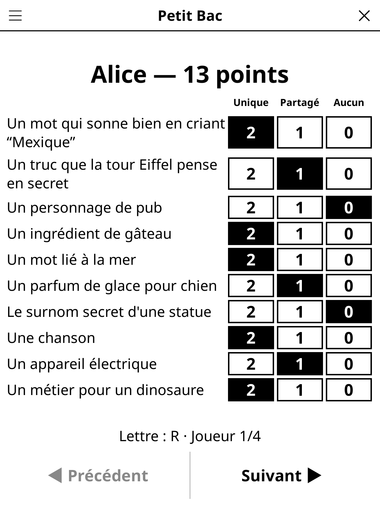

# categories.koplugin

**Categories** (French: *Petit Bac*) for [KOReader](https://github.com/koreader/koreader) — the classic pen-and-paper word game, with the e-reader drawing the letter, the categories and keeping the scores.

## Screenshot



## Concept

Each round the reader draws a letter and 6 to 12 categories: *a country*, *a capital*, *a historical figure*, *a ridiculous name for a dog*, *an excuse for being late*, *something in Mary Poppins' bag*, *a dish Napoleon would have hated*… Everyone writes one answer per category, starting with that letter, on paper. When the timer ends — or someone shouts **Stop!** and taps it — the round is over.

Scoring is done on the reader: one page per player, one row per category, three big cells to tap — **Unique** (nobody else had it), **Shared**, **None**. Labels keep a readable size and wrap; a long list on a small screen is split into even pages (Previous / Next walk through them). Totals run across rounds; after each round a results screen shows the ranking, with **Next round** / **New game** in the action bar.

One player may type their answers instead of writing them: tap a category during the round. Typed answers are shown on the first player's scoring page.

## Features

- Letters weighted by how often they start words; the awkward ones (K, Q, W, X, Y, Z in French — K, Q, U, X, Y, Z in English) only with **Hard letters: On**. No letter comes twice in a game until all have been drawn.
- 457 French and 479 English categories in 8 packs — Classic, Fun, Geography, History & famous people, Pop culture, Food, Absurd, Kids (about 55–65 each) — picked in a multi-select **Category packs** menu that shows each pack's size (default: everything but Kids). No category repeats within a game until the selection runs dry.
- Timer off or 1–5 minutes; only the digits refresh, once a second.
- Configurable points: unique/shared = 2/1, 10/5 or 3/1.
- Player names typed once (one per line) and remembered.
- Content language (FR/EN) independent of the interface language (English, French, Spanish, German).
- The game in progress is saved when the screen is closed, the timer resumes on reopening.

## Settings (title-bar menu)

New game · Language · Players · Categories (6–12) · Timer · Category packs · Hard letters · Scoring · Rules

## Installation

1. Download `categories.zip` from [Releases](../../releases).
2. Extract to your KOReader `plugins/` directory (the shared `game-common` library must be installed too).
3. Restart KOReader — **Categories** appears in the Tools menu.

## Development

`categories.koplugin/` lives inside the
[koreader-plugins](https://github.com/t2ym5u/koreader-plugins) monorepo. Game logic is in `game.lua` (no UI);
the categories are plain Lua tables in `content_fr.lua` / `content_en.lua`. Specs:

```
busted test_game_spec.lua
```

## License

GPL-3.0
